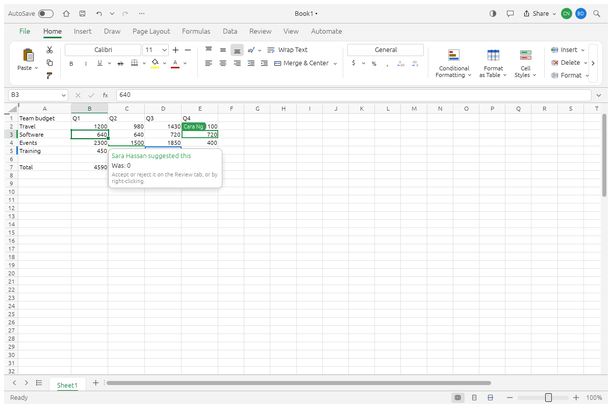
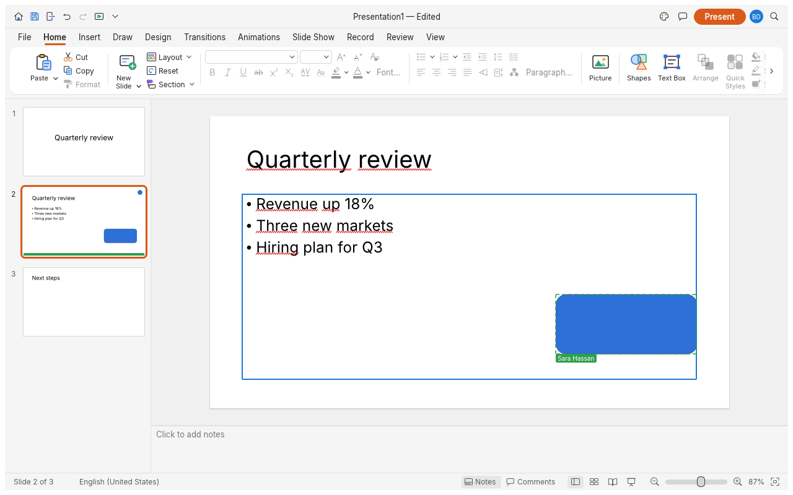
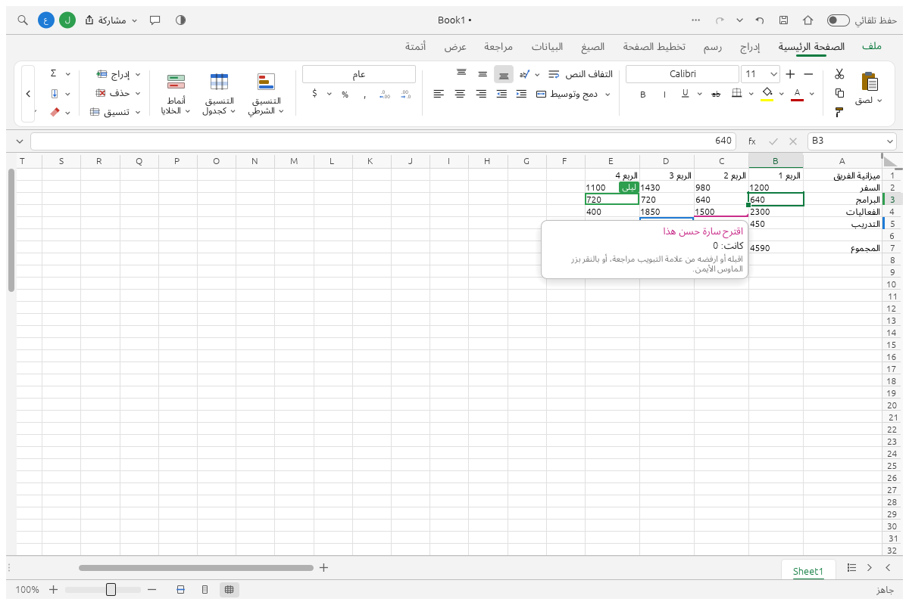
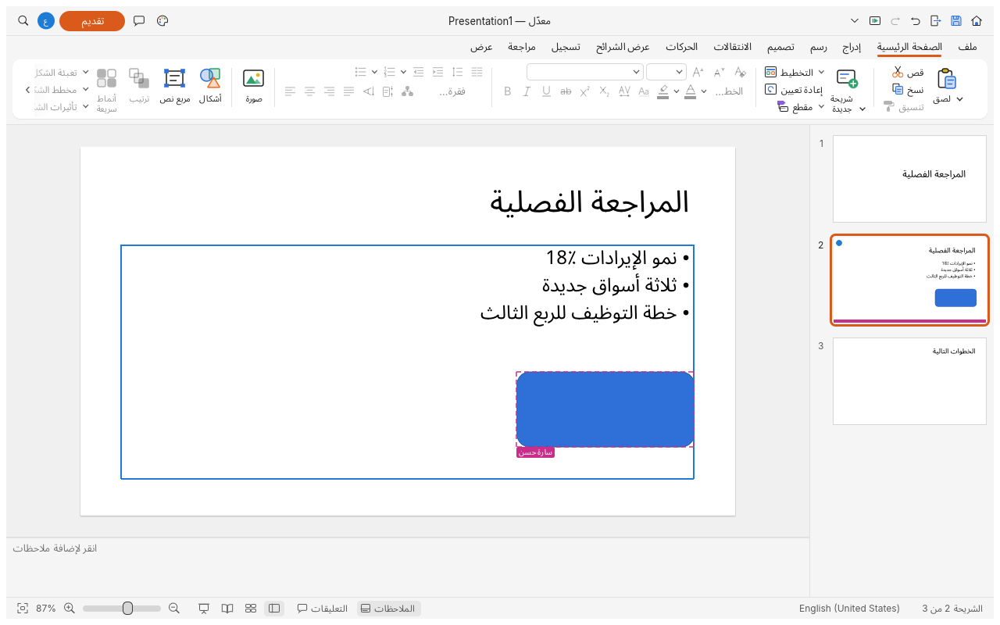

# Craft Collab Suite

**A Word-, Excel- and PowerPoint-style office suite in Rust that runs in the browser, with
real-time co-editing, Arabic done properly, and AI agents as collaborators.**

Version 2.0.0, by [Hossam Taha](https://hossamtaha.me).

Three editors, one way of working together:

| | |
|---|---|
| **Craft Docs** | documents (.docx, .odt, .rtf, PDF…), at the root of this repository (`crates/`, `apps/`) |
| **Craft Sheets** | workbooks (.xlsx, .xls, .ods, .csv…), in [`sheets/`](sheets/README.md) |
| **Craft Slides** | presentations (.pptx, .odp, PDF…), in [`slides/`](slides/README.md) |

Several people edit the same document, workbook or presentation at once: each person's edits
appear instantly on their own screen, everyone else's within a network round trip, and it saves
itself. Embed any of the three in a website with the companion package
[craft-collab-embed](https://github.com/hossamTahaHussein/craft-collab-embed), which includes the
co-editing relay server, the JavaScript SDK and the server-side API.


<table>
<tr>
<td width="50%" valign="top"><p align="center"><sub><b>Craft Sheets.</b> Others' cells in their colours; a suggested change and who made it.</sub></p></td>
<td width="50%" valign="top"><p align="center"><sub><b>Craft Slides.</b> Who is where, and a suggested shape waiting to be accepted or rejected.</sub></p></td>
</tr>
</table>

This project is a modified version of [WordCraft](https://github.com/storytold/wordcraft),
[GridCraft](https://github.com/storytold/gridcraft) and [DeckCraft](https://github.com/storytold/deckcraft)
by the ArtCraft team. It is independent: not made, sponsored or endorsed by the ArtCraft team.

## Co-editing

| | |
|---|---|
| How it syncs | Every edit is a command. Each browser applies its own edits at once; a small relay server puts everyone's edits in one order, and every copy replays them and re-applies its unconfirmed ones on top. The same core (`crates/collab-core`) runs all three editors. |
| Features | Cursors, selected cells and shapes, names and who is present; "Saving…" and "All changes saved" in the header; Undo and Redo of your own edits for everyone (a run of typing is one step); Suggesting per person, accepted or rejected per change, per person or all at once (in Docs, Sheets and Slides); edit, suggest, comment and view roles; version history with preview and restore; read only with "Save my copy" after five minutes offline or 1,000 waiting edits; the relay's HTTP API and signed webhooks; AI agents as participants (`craft-suite-cli --app docs\|sheets\|slides collab-mcp`) |
| Code | `crates/collab-core` (replicas, rebasing, selective undo, protocol, shared by the three), `crates/collab-link` (browser bridge), `crates/collab-ui` (Version history, offline notice), `crates/collab-agent` (agents); each editor's adapter in `crates/collab`, `sheets/crates/collab` and `slides/crates/collab`, and its Suggesting in `sheets/crates/engine/src/suggest.rs` and `slides/crates/engine/src/suggest.rs` |
| Relay and SDK | [craft-collab-embed](https://github.com/hossamTahaHussein/craft-collab-embed) (`relay/`, `src/craft-collab-embed.js`): one relay for all three, `createEditor(el, {app: 'docs' \| 'sheets' \| 'slides'})` |
| Tested | Randomised multi-user convergence tests (with undo and redo) for each editor, one Reject All test per suggestable command, unit tests, end-to-end tests with browsers and a relay restart, agents against the relay, and speed tests (someone else's edit shows in about 1.5 ms in a 100,000-cell workbook and 60 µs in a 100-slide presentation) |

Build the browser apps with co-editing: `trunk build --release` in `apps/wordcraft-web`,
`sheets/apps/gridcraft-web` and `slides/apps/deckcraft-web` (each into its `dist/web`), then serve
them with craft-collab-embed's demo (`EDITOR_DIR=… SHEETS_DIR=… SLIDES_DIR=… npm start`, then open
`/suite.html`). The [latest release](https://github.com/hossamTahaHussein/craft-collab-suite/releases/latest)
has the three builds as zips, which craft-collab-embed's `npm run fetch-editor` downloads.


## Arabic and right to left


<table>
<tr>
<td width="50%" valign="top"></td>
<td width="50%" valign="top"></td>
</tr>
</table>

| | |
|---|---|
| Interface | All three editors translated into Arabic and mirrored: the ribbon, menus, dialogs, panes, rulers and status bar read from the right (`?lang=ar`, or the system language) |
| Writing | Right-to-left paragraphs, tables and sections; right-to-left sheets (column A at the right) and General alignment that follows the text; mixed Arabic and English lines in the right order; Kashida justification in documents, cells and slides; Arabic spell checking in all three |
| Files | Right to left kept in .docx, .xlsx, .pptx, HTML, ODT and RTF; PDFs from all three whose Arabic and Hebrew you can search and copy, vowels included (Chrome's PDF reader splits words at their vowels; Export PDF with `arabicVowels: false` leaves the vowels out of the text for it) |
| Fonts and spelling | Noto Sans Arabic and the Ayaspell Arabic dictionary are bundled, so Arabic looks right and is checked without anything installed |

## Integrations

| | |
|---|---|
| In the page | A JavaScript SDK for all three editors: `run(command, params)` for any command (649 in Craft Docs), `getText`, `getDocument(format)`, `inspect`, `insertText`, `select`, `setReadOnly`, and `change`, `selectionchange`, `presence` and `comment` events |
| On your server | The relay's HTTP API (document info, the document as .docx, PDF or text, commands as live edits, remove a person, close a document) and HMAC-signed webhooks (`joined`, `left`, `saved`, `edited`, `commented`, `restored`) |
| AI agents | `wordcraft-cli collab-mcp` joins a shared document as a named participant over MCP; it suggests by default, and has `who_is_here`, `wait_for_changes`, `comment` and `reply` beside every editor command |

Details, with examples, for all three editors: [craft-collab-embed's README](https://github.com/hossamTahaHussein/craft-collab-embed#api).

## A tour of Craft Docs

Every screenshot below is Craft Docs itself, rendered offscreen by its own UI test harness
(`cargo run -p wordcraft-ui-egui --example ui_shot`).

<table>
<tr>
<td width="50%" valign="top"><p align="center"><sub><b>Review.</b> Track changes, comment balloons in the margin, accept and reject, spelling and grammar as you type.</sub></p></td>
<td width="50%" valign="top"><p align="center"><sub><b>References.</b> Tables of contents, footnotes, citations in APA, MLA, Chicago or IEEE, index and captions.</sub></p></td>
</tr>
<tr>
<td width="50%" valign="top"><p align="center"><sub><b>Design.</b> Themes, style sets, paragraph spacing, watermarks, page colour and borders.</sub></p></td>
<td width="50%" valign="top"><p align="center"><sub><b>Dark mode</b> with formatting marks, and the Insert tab: tables, pictures, shapes, links, headers, footers, fields and symbols.</sub></p></td>
</tr>
<tr>
<td colspan="2"><p align="center"><sub><b>Layout.</b> Drop caps, text wrapping around pictures and shapes, automatic hyphenation, line numbers and page borders.</sub></p></td>
</tr>
<tr>
<td colspan="2"><p align="center"><sub><b>File.</b> Start from a template, open recent documents, edit properties, export to PDF and other formats.</sub></p></td>
</tr>
</table>

## What works today in Craft Docs

Craft Sheets' and Craft Slides' feature lists are in [sheets/README.md](sheets/README.md) and
[slides/README.md](slides/README.md).


| Area | Highlights |
|---|---|
| **Writing** | Fast typing with IME, smart quotes, AutoCorrect, list autoformat (`* `, `1. `), dashes; word, sentence, paragraph selection; drag-select; clipboard with formatting; undo/redo; find and replace with regex |
| **Formatting** | Fonts, sizes, bold/italic/underline styles, strike, sub/superscript, caps, highlight, colours, character spacing, Format Painter, Change Case, Clear Formatting |
| **Paragraphs** | Alignment, indents (draggable on the ruler), spacing, line spacing, tabs with leaders, borders, shading, keep with next, widow/orphan control |
| **Styles** | Built-in style set, live gallery, Styles pane, create/modify/update styles, style sets, themes |
| **Lists** | Bullets, numbering, multilevel, restart, set value, custom formats |
| **Tables** | Insert by grid, merge/split, styles with banded rows, borders, shading, header rows repeated across pages, rows that split across pages, sort, formulas, text ↔ table |
| **Pages** | Margins, orientation, size, columns, page/column/section breaks, headers and footers (first page, odd/even), page numbers, watermark, page borders, line numbers, vertical alignment, drop caps, automatic hyphenation |
| **Objects** | Pictures (resize, crop, recolour, brightness/contrast, transparency, background removal, picture styles, rotate), shapes, text boxes, floating position with text wrapping (square, top and bottom, behind or in front of text) |
| **References** | Table of contents, footnotes and endnotes, citations and bibliography (APA, MLA, Chicago, IEEE), captions, table of figures, cross-references, index, table of authorities |
| **Review** | Spelling and grammar with suggestions (English, Arabic, Polish and more, by each run's language; Arabic words in the right-to-left language), thesaurus, word count, comments in margin balloons or a pane, track changes, accept/reject, compare documents, restrict editing, accessibility checker, document inspector |
| **Mailings** | Mail merge from CSV, merge fields, address block, greeting line, rules, preview, finish to a document; envelopes and labels |
| **View** | Print layout, web layout, draft, read mode, focus, zoom, one/multiple pages, page width, Navigation pane, rulers, gridlines, dark mode; interface in English, العربية, 简体中文, 繁體中文, 日本語, Português (Brasil), Español, Українська, Српски / Srpski, Eesti, Türkçe, Русский, Italiano, Deutsch, Polski, Čeština, Magyar, Français, Български, Tiếng Việt, 한국어, Svenska, Hrvatski or Slovenščina (follows the system language by default) |
| **Files** | .docx read/write, legacy 97-2003 .doc import, PDF export, .odt, .rtf, .html, .md, .tex, .txt import/export, page images |

The honest picture, area by area, is in [ROADMAP.md](ROADMAP.md), the
[parity assessment](docs/target-app-parity.md) and the generated
[feature checklist](docs/parity-checklist.md).

## Quick start

```sh
git clone https://github.com/hossamTahaHussein/craft-collab-suite
cd craft-collab-suite
cargo build --release -p wordcraft -p gridcraft -p deckcraft -p craft-suite
target/release/craft-suite                          # the start window: new document, workbook or presentation
target/release/craft-suite budget.xlsx              # open a file in the editor its extension names
cargo run --release -p wordcraft -- --sample        # Craft Docs with the sample document
```

The suite's command line runs each editor's own: `craft-suite-cli --app sheets convert budget.xlsx budget.pdf`
(`--app docs` is the default).

Command line:

```sh
wordcraft-cli convert report.docx report.pdf        # docx, pdf, odt, rtf, html, md, tex, txt, png
wordcraft-cli text report.docx                      # plain text
wordcraft-cli inspect report.docx                   # structure as JSON
wordcraft-cli run --template sample \
  --cmd 'select.text={"text":"Membership"}' --cmd format.bold --save out.docx
wordcraft-cli run --script job.json                 # the same from a file: commands, then save to docx and pdf
```

Web: `cd apps/wordcraft-web && trunk serve`, then open <http://127.0.0.1:8771/?sample> (Craft
Sheets and Craft Slides: `trunk serve` in `sheets/apps/gridcraft-web` or `slides/apps/deckcraft-web`).

## For agents: CLI and MCP

All three editors were designed to be driven by people *and* by AI agents
(`gridcraft-cli mcp` and `deckcraft-cli mcp` serve Craft Sheets' and Craft Slides' commands the same way).

```sh
claude mcp add wordcraft -- wordcraft-cli mcp                  # headless documents
# confine the agent to folders: wordcraft-cli mcp --automation-read-root DIR --automation-write-root DIR
wordcraft --control 7981 &                                     # or drive the running app…
claude mcp add wordcraft-app -- wordcraft-cli mcp --connect 127.0.0.1:7981
```

Tools include `list_commands`, `execute`, `batch`, `type_text`, `select_text`, `inspect_document`,
`render_page`, `save_document`, and, with a running app, `screenshot`, `click` and `key`. Agents
can check their work through `inspect_document` without screenshots. See [docs/mcp.md](docs/mcp.md)
and the [control protocol](docs/control-protocol.md). Macros record any sequence of commands and
play it back (`tools.recordMacro`, `tools.macros`).

## Logs

The desktop app writes its log records to standard error and to `logs/wordcraft.log` next to its
preferences: on Linux `$XDG_CONFIG_HOME/wordcraft/logs/` (by default `~/.config/wordcraft/logs/`),
on macOS `~/Library/Application Support/WordCraft/logs/`, on Windows `%APPDATA%\WordCraft\logs\`.
A start from a desktop menu or the Dock has no terminal, so this file is what to attach to a bug
report: unreadable parts of a .docx, pictures or fonts a PDF export had to leave out and panics the
command guard recovered from land there. Each launch moves the previous log to `wordcraft.1.log`
(and that one to `wordcraft.2.log`), so the log of a run that crashed survives the next start; a
log stops growing at 16 MiB. `--version` writes no file, and runs with `WORDCRAFT_NO_PREFS` (agents'
test runs) log to standard error only. Document text is never logged; a panic message leaves out
the text it quotes.

By default WordCraft's own crates log at `info` and everything else at `warn`. `RUST_LOG` replaces
that with env_logger-style directives, for example `RUST_LOG=debug`,
`RUST_LOG=warn,wordcraft_docx=trace` or `RUST_LOG=info,wgpu_core=warn`; a directive ending in `*`
covers every target starting with it (`wordcraft*=debug`). The logger is
`apps/wordcraft/src/logging.rs`.

## Architecture

| Layer | Crate | Job |
|---|---|---|
| L0 | `wordcraft-geom` | units and measurements |
| L1 | `wordcraft-doc`, `wordcraft-fonts`, `wordcraft-proof` | document model and editing; fonts and shaping; spelling, grammar, hyphenation |
| L2 | `wordcraft-layout`, `wordcraft-docx`, `wordcraft-formats` | line breaking, pagination, tables, notes, hit testing; OOXML; ODT/RTF/HTML/Markdown/TXT |
| L3 | `wordcraft-render`, `wordcraft-pdf` | rasteriser (vello_cpu); PDF ([craft-pdf](docs/shared-pdf.md), Krilla) |
| L4 | `wordcraft-engine` | session, undo, 649 commands, document feature catalog |
| L5 | `wordcraft-mcp`, `wordcraft-collab` | MCP server; co-editing replicas, rebasing, selective undo, protocol |
| L6 | `wordcraft-ui-egui` | the word processor front end (swappable) |
| apps | `wordcraft`, `wordcraft-cli`, `wordcraft-web` | desktop, command line, browser |

Craft Sheets and Craft Slides keep their own layered crates (`gridcraft-*` in `sheets/`, `deckcraft-*`
in `slides/`, checked by `cargo xtask-sheets layers` and `cargo xtask-slides layers`); the suite's
shared crates are `craft-collab-core`, `craft-collab-link`, `craft-collab-ui` and `craft-collab-agent`,
and `apps/craft-suite` is the start window and command line.

`cargo xtask ci` runs formatting, clippy, ~800 tests, the asset-attribution check, the layering
check and the wasm build. Contributor guidelines: [CONTRIBUTING.md](CONTRIBUTING.md).

## License and credits

Dual-licensed under [MIT](LICENSE-MIT) or [Apache-2.0](LICENSE-APACHE), at your option, like
WordCraft, GridCraft and DeckCraft. Required notices are in [NOTICE](NOTICE); bundled fonts, icons and other assets keep
their own open licenses, listed in [ATTRIBUTION.md](ATTRIBUTION.md).

Craft Collab Suite (co-editing, Suggesting, Arabic and right to left, the integrations, the agents
and the suite) is by [Hossam Taha](https://hossamtaha.me). Based on WordCraft, GridCraft and
DeckCraft, Copyright (c) 2026 ArtCraft Team and the WordCraft, GridCraft and DeckCraft contributors. The ArtCraft name and logos are trademarks of the ArtCraft Team and are
not used in this project.

<sub>Microsoft, Microsoft Word, Excel and PowerPoint are trademarks of the Microsoft group of companies. This project
is not affiliated with, sponsored by or endorsed by Microsoft Corporation.</sub>
