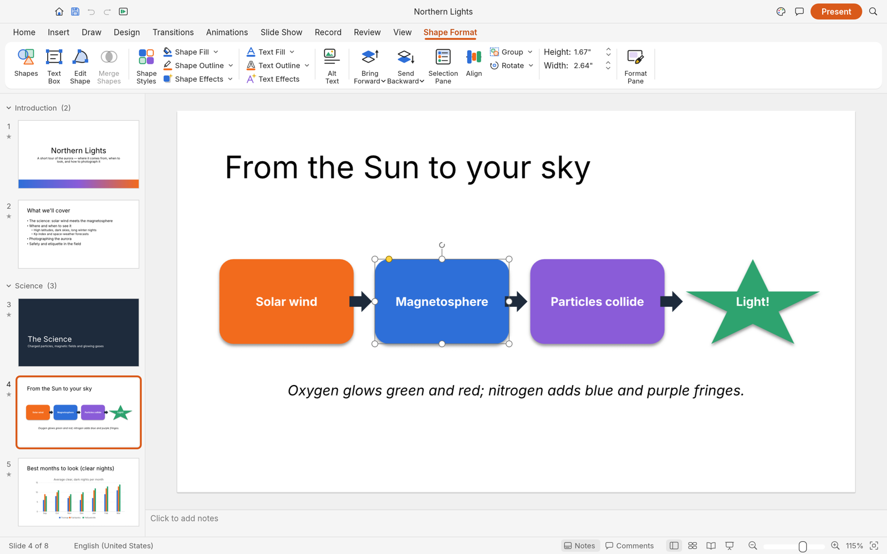
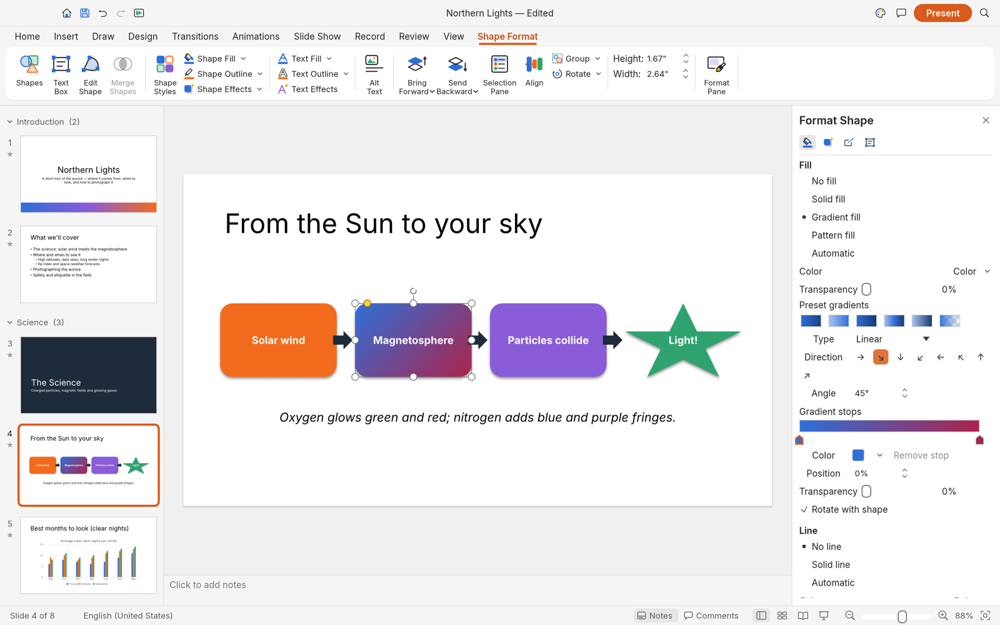
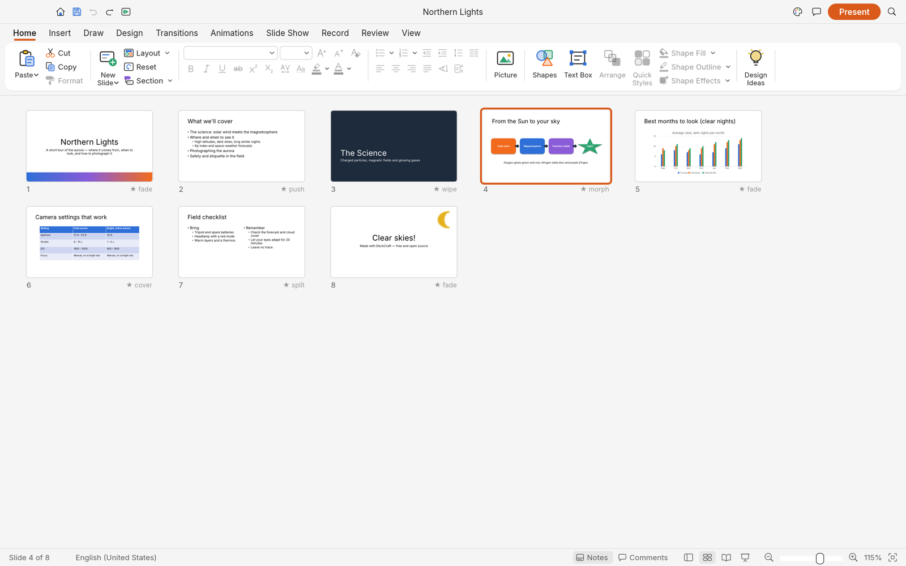
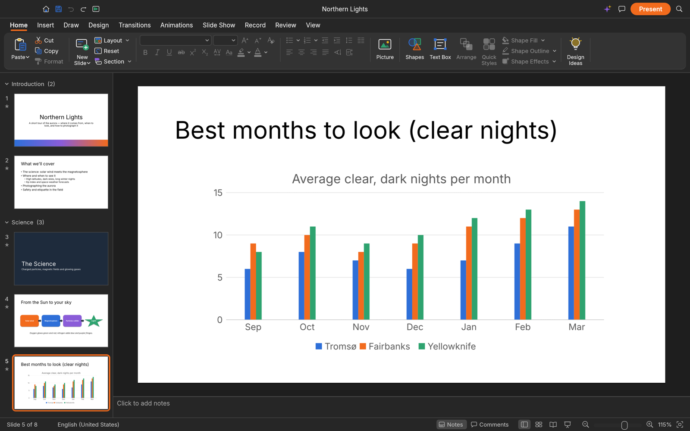
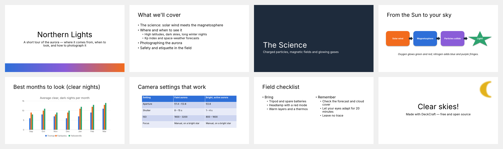

# Craft Slides

The presentation app of [WordCraft Collab](https://github.com/hossamTahaHussein/wordcraft-collab): an open-source, clean-room presentation app in pure Rust, with
real-time co-editing (in progress) alongside Craft Docs. Based on [DeckCraft](https://github.com/storytold/deckcraft) by the
ArtCraft team; this modified version is independent: it is not made, sponsored or endorsed by the ArtCraft team.

In this repository it lives under `slides/` and builds in the one suite workspace at the root:
`cargo run -p deckcraft` (desktop) and `cd slides/apps/deckcraft-web && trunk build --release` (browser).
Its tests read the bundled fonts from a [craft-fonts](https://github.com/storytold/craft-fonts)
checkout: `CRAFT_FONTS_DIR=../craft-fonts cargo test -p deckcraft-ui-egui`.

## What works today

DeckCraft is in alpha, heading for beta (see the [roadmap](ROADMAP.md)).
Today it can:

- **Make decks**: slide masters and eleven layouts with placeholders that inherit position and
  formatting, eight original themes with colour and font schemes, sections, notes, comments,
  headers and footers, custom slide sizes.
- **Draw**: 150+ preset shapes with adjust handles, connectors that stay glued to shapes, freeform,
  curve and scribble tools, merge shapes (union, combine, fragment, intersect, subtract), gradient,
  picture and pattern fills, outlines with dashes and arrowheads, shadows, glow, soft edges and
  reflections.
- **Write**: in-place text editing with full font and paragraph formatting, bullets and numbering,
  columns, autofit, vertical text, fields and hyperlinks.
- **Add content**: pictures with crop and corrections, tables with styles, charts, SmartArt basics,
  audio and video (MP3, AAC, FLAC, ALAC, Ogg, Opus, WAV, AIFF; H.264, HEVC, VP9, AV1).
- **Present**: transitions (including Morph), entrance/emphasis/exit and motion-path animations,
  by-paragraph builds, full-screen slide show, presenter view, pen, rehearse timings, media playback.
- **Exchange files**: open and save .pptx presentations, export PDF (slides, notes pages, handouts
  with selectable text), PNG/JPEG, an animated GIF of the deck and outlines. Unsaved work is kept by AutoRecover.
- **Automate**: 200+ commands with undo, all scriptable from the CLI, a JSON control channel and an
  MCP server for AI agents.

<table>
  <tr>
    <td width="50%"><br><sub>Shape Format contextual tab and selection handles</sub></td>
    <td width="50%"><br><sub>Format Shape pane: gradient type, direction and stops</sub></td>
  </tr>
  <tr>
    <td width="50%"><br><sub>Slide Sorter with each slide's transition</sub></td>
    <td width="50%"><br><sub>Dark mode, with a native chart</sub></td>
  </tr>
</table>

<p align="center">
  <br>
  <sub>The built-in sample deck, rendered by <code>deckcraft-cli render --sample --all</code></sub>
</p>

## Getting started

PDF export uses the shared `craft-pdf` writer with import features disabled. See
[`crates/pdf/README.md`](crates/pdf/README.md) for the dependency and validation requirements.

```sh
git clone https://github.com/storytold/deckcraft
cd deckcraft
cargo run --release -p deckcraft-cli -- render --sample --all --scale 1 out/
```

On Linux, the build also needs the ALSA headers for slide-show sound: `alsa-lib-devel` on Fedora,
`libasound2-dev` on Debian and Ubuntu, `alsa-lib` on Arch. Without them it stops at `alsa-sys`.

Fonts come from [craft-fonts](https://github.com/storytold/craft-fonts): clone it next to this repo
(`../craft-fonts`) and local builds pick it up automatically; without it DeckCraft uses your system
fonts.

Each [GitHub release](https://github.com/storytold/deckcraft/releases) has ready-made builds, on Linux as
an AppImage, a `.deb`, an `.rpm` and a tarball. On Gentoo, the community [::snakebyte
overlay](https://github.com/switch87/snakebyte-overlay) packages the Linux release as
`app-office/deckcraft-bin` (not maintained by the DeckCraft team):

```sh
eselect repository add snakebyte git https://github.com/switch87/snakebyte-overlay.git
emaint sync -r snakebyte
echo 'app-office/deckcraft-bin ~amd64' >> /etc/portage/package.accept_keywords/deckcraft
emerge --ask app-office/deckcraft-bin
```

### Logs

The desktop app writes its `log` records to standard error and to `logs/deckcraft.log` in the
settings directory, beside `ui.json` and `prefs.json` (Linux `~/.config/deckcraft/logs/`, or
`$XDG_CONFIG_HOME/deckcraft/logs/`; macOS `~/Library/Application Support/DeckCraft/logs/`; Windows
`%APPDATA%\DeckCraft\logs\`). A start from a desktop menu or the Dock has no terminal, so this file
is what to attach to a bug report: the crash guard's panic report, a failed crash-recovery save,
Parts skipped on import and audio output problems land there. Each launch moves the
previous log to `deckcraft.1.log` (and that one to `deckcraft.2.log`), so the log of a run that
crashed survives the next start. The file stops growing at 16 MiB. `--version` writes no file.

| Variable | Effect |
|---|---|
| `RUST_LOG` | Log levels for standard error and the log file. Default: `info` for DeckCraft's own crates, `warn` for everything else. env_logger-style directives replace that, e.g. `RUST_LOG=debug`, `RUST_LOG=warn,deckcraft_pptx=trace` or `RUST_LOG=info,wgpu_core=warn`; a directive ending in `*` covers every target starting with it (`deckcraft*=debug`). |

The logger is `apps/deckcraft/src/logging.rs`; the realtime audio callback does not log. The web
app logs to the browser console instead.

## Agents, CLI and MCP

Every action in DeckCraft is a command with a stable id, so people, scripts and AI agents use the
same verbs:

```sh
deckcraft-cli commands format.          # list commands
deckcraft-cli run --sample --cmd 'slide.new={"layout":"titleOnly","title":"Hello"}' --save hello.deckcraft
deckcraft-cli mcp                       # MCP server over stdio (headless)
deckcraft-cli mcp --connect 7990        # drive the running app (deckcraft --control 7990)
deckcraft-cli mcp --automation-read-root DIR --automation-write-root DIR   # confine the headless agent to folders
```

## Roadmap

DeckCraft is in **alpha**. It covers **84% of the features tracked in [`docs/target-app-parity.md`](docs/target-app-parity.md) by breadth** (92% of the core
ones, measured) and is about **55% ready for real work across all tracked capabilities** (estimated).
See [ROADMAP.md](ROADMAP.md) for the stage, numbers by dimension and what's next,
[docs/target-app-parity.md](docs/target-app-parity.md) for the full assessment,
[docs/gaps.md](docs/gaps.md) for every known shortfall and
[docs/parity-checklist.md](docs/parity-checklist.md) for the feature-by-feature checklist.

## License and credits

MIT OR Apache-2.0, at your option ([LICENSE-MIT](LICENSE-MIT), [LICENSE-APACHE](LICENSE-APACHE)).
Based on DeckCraft, Copyright (c) 2026 ArtCraft Team and the DeckCraft contributors; co-editing and suite
additions Copyright (c) 2026 [Hossam Taha](https://hossamtaha.me). The ArtCraft name and logos are
trademarks of the ArtCraft Team and have been removed from this modified version, as their brand
terms require.
Third-party material: [ATTRIBUTION.md](ATTRIBUTION.md) and [NOTICE](NOTICE).
